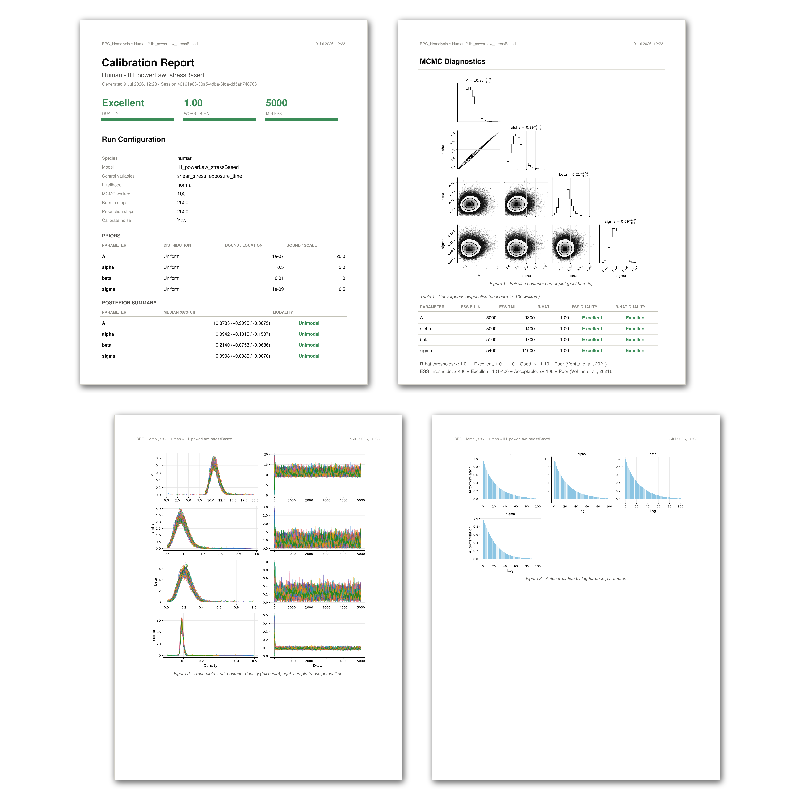

# Bayesian Parameter Calibration in Blood Hemolysis Modeling

<p align="left">
  
</p>

This computational study was developed using
[SHOWME.how](https://mbd-rwth.github.io/showmehow/) approach.

<p align="left">
  
  &nbsp;&nbsp;&nbsp;
  
</p>


In this computational study, we calibrate the parameters of a computational
hemolysis model against experimental data. Hemolysis models predict the fraction
of red blood cells damaged when blood is subjected to mechanical stress, and are
used to assess blood-handling medical devices such as ventricular assist devices.
However, such models rely on empirical coefficients that must be identified from
experimental data before the model can be applied predictively.

Here the coefficients are inferred within a Bayesian framework: rather than a
single best fit, the calibration returns posterior distributions over the
parameters, so that both the experimental errors and model uncertainty are carried
through into the estimates. Inference is performed with Markov Chain Monte Carlo,
and the same setup can be applied to individual experimental data of different species
and competing hemolysis model formulations.

The report below, automatically generated after each calibration study, provides a run summary, calibrated parameters, and diagnostics.

<p align="left">
  <a href="assets/teaser/human_IH_powerLaw_stressBased_40161e63-30a5-4dba-8fda-dd5aff748763/report.pdf">
    
  </a>
</p>


## Components of the study

### Computational units

- **Forward model** predicts a hemolysis index from the flow conditions
  (control variables) and the model parameters. It is implemented in both
  **Python** and **Julia**, selectable at runtime via `model.use_julia`.
- **MCMC calibration** infers the posterior over the parameters with the
  affine-invariant ensemble sampler (Goodman & Weare) as implemented in
  [`emcee`](https://emcee.readthedocs.io/), with a configurable likelihood
  (Gaussian or Student's t), a configurable observation-noise model (a fixed
  guess, or a scale inferred from the data that is constant, proportional or
  affine in the predicted hemolysis index), and configurable priors. Inference
  results are exported as NetCDF via [ArviZ](https://python.arviz.org/).
- **Report** compiles the calibration results (including the sampler traces) into
  a generated report; **diagnostics** compute convergence statistics;
  **comparison** reduces a whole sweep to one set of tables and figures.

### Data

- **Blood hemolysis measurements** for different species (human, bovine, ovine,
  porcine), fetched from a remote data repository and preprocessed into a common
  CSV format.
- **Deterministic calibration data** (`deterministic_calibration/`): reference
  coefficient sets from the literature, in JSON.

### Human collaborators

- **Nico Dirkes** | CATS, RWTH Aachen | blood hemolysis modeling specialist
- **V. Mithlesh Kumar** | MBD, RWTH Aachen | uncertainty quantification
- **Alan Correa** | MBD, RWTH Aachen | research software engineering

## Installation

1. **Conda / Mamba / Micromamba**: a package manager for the unit environments
   ([Conda](https://docs.conda.io/projects/conda/en/latest/user-guide/install/index.html) /
   [Mamba](https://github.com/conda-forge/miniforge#install) /
   [Micromamba](https://mamba.readthedocs.io/en/latest/installation/micromamba-installation.html#automatic-install)).
2. Create and activate the project environment (this also installs Nextflow):
   ```
   conda env create -f environment.yml
   conda activate showmehow
   ```
3. A container runtime for the **Julia** forward model:
   [Docker](https://docs.docker.com/get-docker/) locally, or
   [Apptainer](https://apptainer.org/docs/admin/latest/installation.html#installing-apptainer)
   on HPC.

## Usage

1. **Single calibration** runs one configuration:
   ```
   nextflow run main.nf --config_file params.yml
   ```
   `params.yml` sets the `species`, the model, whether to use the
   Julia forward model (`model.use_julia`), and the calibration settings and
   priors. Ready-made configs for each model variant are provided as `params-*.yml`.

2. **Orchestrated experiments** run a sweep over many configurations. Define the
   combinations in `experiments.yml`, then:
   ```
   nextflow run experiments.nf --config_file experiments.yml
   ```
   Every combination of the `sweep` dimensions produces one calibration, sharing
   the common calibration and model-server settings. Nextflow limits concurrency
   to the available resources and skips runs that have already completed on a
   rerun (`-resume`). After the last calibration finishes, one comparison over
   the whole sweep is written to `comparison/` inside the sweep directory.

   Sweep dimensions:

   | Dimension | Levels | What it varies |
   | --- | --- | --- |
   | `species` | `human`, `bovine`, `ovine`, `porcine` | which data set is calibrated against |
   | `models` | `IH_powerLaw_stressBased`, `IH_powerLaw_strainBased`, `IH_poreFormation_stressBased`, `IH_poreFormation_strainBased` | the hemolysis model |
   | `prior_configuration` | any key of `prior_configurations` | the prior family per parameter (e.g. vague uniform vs. informative truncated Gaussian) |
   | `likelihood` | `normal`, `student_t` | the observation distribution; Student's t has heavier tails, its degrees of freedom set by `calibration.likelihood_dof` |
   | `noise_model` | `heuristic`, `uniform`, `linear`, `affine` | how the observation noise scale is obtained |
   | `data_mode` | `raw`, `averaged` | whether measurement repetitions stay separate or are collapsed to their group mean |

   The noise scale of observation *i* is `sigma_i = sigma + sigma_rel * IH_i`,
   with only the terms of the chosen model active:

   | `noise_model` | Free parameters | Scale |
   | --- | --- | --- |
   | `heuristic` | none | fixed `calibration.noise_sigma` |
   | `uniform` | `sigma` | constant, independent of IH |
   | `linear` | `sigma_rel` | proportional to IH |
   | `affine` | `sigma`, `sigma_rel` | a floor plus an IH-proportional part |

   Calibrated noise parameters are sampled alongside the model parameters, so
   they need a prior in `prior_library` and in the selected prior configuration.

3. **Execution profiles** select the container engine with `-profile`:
   - `-profile local` (**default** if omitted): Docker, for a local workstation.
   - `-profile cluster`: Apptainer, for a shared cluster node. Process execution
     still uses the local executor (no batch scheduler yet).

   ```
   nextflow run main.nf --config_file params.yml -profile cluster
   ```

   **CPU budget** — `--max_cpus N` caps the cores used for concurrency. It is a
   *total* budget shared across concurrently running experiments; each experiment
   consumes `model.n_workers + calibration.n_workers` cores. When unset, all
   detected cores are used (the `cluster` profile defaults it to `8`, or to
   `NXF_MAX_CPUS` if that environment variable is set):
   ```
   nextflow run main.nf --config_file params.yml -profile cluster --max_cpus 16
   ```

4. **Reproducible environments.** Each unit declares its environment in
   `main.nf` (`conda "<unit>/environment.yml"`); how that is resolved is managed in
   `nextflow.config` from flags. Each run picks, per unit, the first that applies:

   | Mode | Flag | What a unit uses |
   | --- | --- | --- |
   | Locked (default) | — | committed `<unit>/lockfile/conda-<platform>.lock` |
   | Unlocked | `--useLockFiles false` | solve `<unit>/environment.yml` at runtime |
   | Containerized | `--containerized` | the unit's image from GHCR, no conda |

   ```
   nextflow run main.nf --config_file params.yml                 # locked
   nextflow run main.nf --config_file params.yml --containerized # images from GHCR
   ```
   - `--lockPlatform` is **auto-detected** from the host
     (`linux-64` | `linux-aarch64` | `osx-64` | `osx-arm64` | `win-64`); override if needed.
   - A unit with no lock for the platform (e.g. `model`/`mcmc`, whose pip-only
     `umbridge` can't survive an explicit lock) falls back to its `environment.yml`.
   - `--condaEngine` is `conda` (default), `mamba`, or `micromamba`.

   Editing a `<unit>/environment.yml` triggers one CI pipeline (`conda-recipes.yml`):
   it re-locks conda-only units (or adds a micromamba `Dockerfile` to units that
   can't be locked), commits, then builds & pushes each unit's image to GHCR
   (`:latest` + `:<sha>`) **from the updated locks** for `--containerized`.

## Repository structure

Main components:

| Path | What it is |
| --- | --- |
| `main.nf` | Nextflow workflow for a single calibration |
| `experiments.nf` | Nextflow orchestrator for a sweep of experiments |
| `params.yml`, `params-*.yml` | Configs for single runs (one per model variant) |
| `experiments.yml` | Sweep configuration |
| `model/` | **Python** forward model |
| `model_julia/` | **Julia** forward model (Docker / Apptainer) |
| `mcmc/` | MCMC calibration client (`emcee`) |
| `report/`, `diagnostics/` | Generated report and convergence diagnostics |
| `comparison/` | Cross-experiment comparison over a finished sweep |

Supporting units: `pull_data/` (fetch experimental data), `preprocessing/`
(convert raw data to CSV), `experiments/` (generate the sweep), `deterministic_calibration/`
(literature reference coefficients).

### Comparing a finished sweep

`comparison/` reduces a whole sweep to the artefacts that answer "what did the
modeling choices actually change?" — a per-run summary table, an ELPD ranking, a
sensitivity table, and three figures. It runs automatically at the end of
`experiments.nf`, and standalone on any directory of bundles:

```
python comparison/compare_experiments.py \
    --sweep-dir outputs/experiments/<run> --output-dir comparison
```

Each calibration also writes `predictive_idata.nc` next to `mcmc_idata.nc`: the
pointwise log likelihood and the posterior predictive on a thinned set of post
burn-in draws. That is what LOO/WAIC and the predictive checks need, and it can
only be produced while the model server is still up.

The ELPD ranking is stratified by `data_mode`, because leave-one-out compares
models by the density they assign to *the same* observations — the raw and
averaged data sets are different observation sets, so their ELPDs are not on a
common scale. Prior, likelihood and noise model leave the observations untouched
and are therefore directly comparable.


## Roadmap

- [x] Add Conda lock files for reproducible environments.
- [x] Add CI automation.
- [x] Add Nextflow profiles (`local` / `cluster`) to switch the container engine
      between Docker and Apptainer.
- [x] Publish the Julia forward model image to GHCR (multi-arch) and consume it
      from both profiles (Apptainer pulls it via `docker://`).

## Contact

Alan Correa | MBD, RWTH Aachen ([@thealanjason](https://github.com/thealanjason)).

## Contributing

See [CONTRIBUTING.md](CONTRIBUTING.md).

## How to cite

<!-- TODO: add citation for this computational study. -->

## References

- Dirkes, N., & Behr, M. (2026). *A practical computational hemolysis model
  incorporating biophysical properties of the red blood cell membrane.* arXiv.
  https://doi.org/10.48550/arXiv.2601.19994
- Blum, C., Steinseifer, U., & Neidlin, M. (2025). *Toward uncertainty-aware
  hemolysis modeling: A universal approach to address experimental variance.*
  International Journal for Numerical Methods in Biomedical Engineering, 41,
  e70040. https://doi.org/10.1002/cnm.70040
